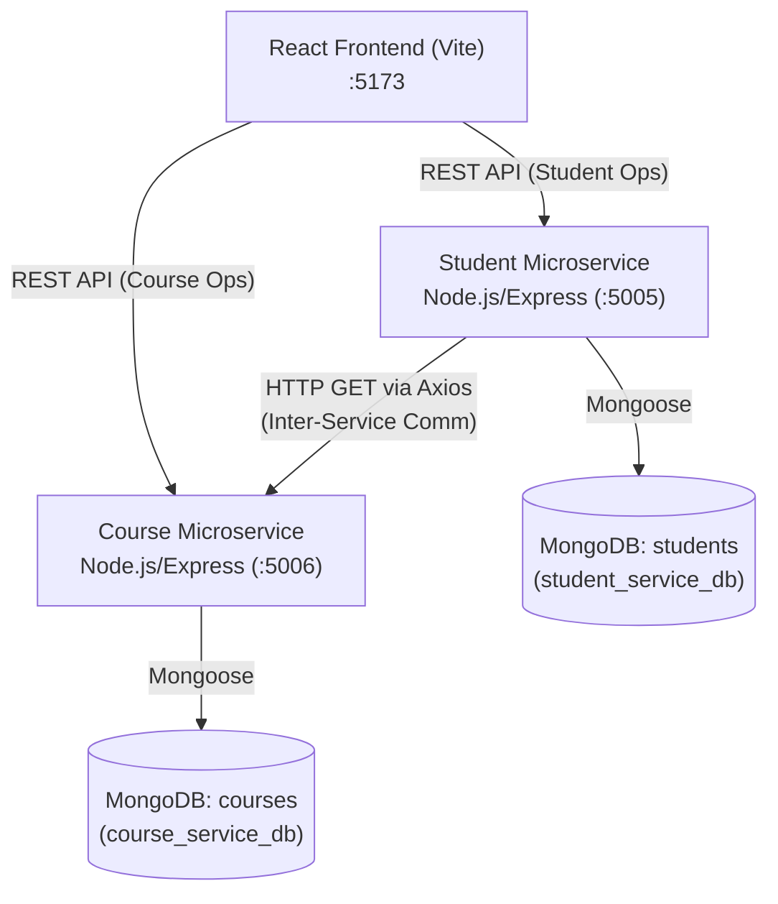

# Student–Course Management System Using MERN Microservices

A complete, production-ready, beginner-friendly **Student–Course Management System** built using the **MERN** stack and modern **Microservices Architecture**. Designed specifically for college practical examinations (worth 20 marks), showcasing independent service separation, dedicated MongoDB databases, genuine RESTful inter-service communication over HTTP, and cloud deployment readiness (Render + Vercel).

---

## 1. System Architecture

The application is decomposed into three completely independent applications:

```
                      ┌─────────────────────────────────────────┐
                      │          React Frontend (Vite)          │
                      │               Port: 5173                │
                      └──────────────┬────────────┬─────────────┘
                                     │            │
            REST API (Student CRUD)  │            │ REST API (Course CRUD)
                                     ▼            ▼
             ┌─────────────────────────┐        ┌─────────────────────────┐
             │     Student Service     │        │     Course Service      │
             │       Port: 5005        │        │       Port: 5006        │
             └────────────┬────────────┘        └────────────┬────────────┘
                          │                                  │
                          │   HTTP GET /api/courses/:id      │
                          │   (Axios Inter-Service Call)     │
                          └─────────────────────────────────►│
                          │                                  │
                          ▼                                  ▼
             ┌─────────────────────────┐        ┌─────────────────────────┐
             │   MongoDB Collection:   │        │   MongoDB Collection:   │
             │        students         │        │         courses         │
             │  (student_service_db)   │        │   (course_service_db)   │
             └─────────────────────────┘        └─────────────────────────┘
```

### Mermaid Architecture Diagram



---

## 2. Project Directory Structure

```
student-course-management/
├── .gitignore                      # Excludes node_modules, .env, build files
├── README.md                       # Comprehensive guide, API docs & viva prep
├── course-service/                 # Independent Course Microservice
│   ├── .env                        # Local environment variables (PORT=5006)
│   ├── .env.example                # Sample environment template
│   ├── package.json
│   └── src/
│       ├── config/
│       │   └── db.js               # MongoDB connection logic (course_service_db)
│       ├── controllers/
│       │   └── courseController.js # Course CRUD handlers
│       ├── models/
│       │   └── Course.js           # Course Mongoose schema
│       ├── routes/
│       │   └── courseRoutes.js     # /api/courses routes
│       └── server.js               # Express application entry point (:5006)
├── student-service/                # Independent Student Microservice
│   ├── .env                        # Local environment variables (PORT=5005)
│   ├── .env.example                # Sample environment template
│   ├── package.json
│   └── src/
│       ├── config/
│       │   └── db.js               # MongoDB connection logic (student_service_db)
│       ├── controllers/
│       │   └── studentController.js# Student CRUD & Inter-Service handlers
│       ├── models/
│       │   └── Student.js          # Student Mongoose schema (references course IDs)
│       ├── routes/
│       │   └── studentRoutes.js    # /api/students routes
│       ├── services/
│       │   └── courseClient.js     # Axios HTTP client for Course Service (:5006)
│       └── server.js               # Express application entry point (:5005)
└── frontend/                       # React Frontend Single Page App
    ├── .env                        # Local environment variables (API URLs)
    ├── .env.example                # Sample environment template
    ├── index.html                  # HTML entry point
    ├── package.json
    ├── vite.config.js              # Vite configuration (:5173)
    └── src/
        ├── App.css                 # Responsive modern styling
        ├── App.jsx                 # Dashboard orchestration & navigation
        ├── index.css               # Global typography and base CSS
        ├── main.jsx                # React DOM mount point
        ├── components/
        │   ├── CourseManager.jsx   # Add course form & courses list
        │   ├── Navbar.jsx          # Live health badges & refresh controls
        │   ├── StudentCourseDetails.jsx # Inter-service aggregation showcase
        │   └── StudentManager.jsx  # Add student form & students list
        └── services/
            └── api.js              # Axios API client for both services
```

---

## 3. Technology Stack

| Layer | Technology | Purpose |
|---|---|---|
| **Frontend** | React 18, Vite | High-performance SPA with modern component architecture (:5173) |
| **Icons & UI** | Lucide React | Clean, intuitive icons for dashboard badges and actions |
| **Backend** | Node.js, Express.js | Lightweight, event-driven RESTful microservices (:5005, :5006) |
| **Database** | MongoDB & Mongoose | Document database with schema validation and separate DBs |
| **Inter-Service** | Axios (HTTP REST) | Genuine decoupled communication over network protocols |
| **Deployment** | Render & Vercel | Render for microservices backends, Vercel for React frontend |

---

## 4. Installation & Local Setup

### Prerequisites
- **Node.js**: v18 or higher (`node -v`)
- **npm**: v9 or higher (`npm -v`)
- **MongoDB**: Local MongoDB instance (`mongodb://localhost:27017`) OR a MongoDB Atlas cluster URI.

### Step 1: Navigate to the Project
```bash
cd "/Users/deepthi/Desktop/Student Corse Mgt"
```

### Step 2: Configure Environment Variables

#### Course Service (`course-service/.env`):
```env
PORT=5006
MONGODB_URI=mongodb://localhost:27017/course_service_db
FRONTEND_URL=http://localhost:5173
```

#### Student Service (`student-service/.env`):
```env
PORT=5005
MONGODB_URI=mongodb://localhost:27017/student_service_db
COURSE_SERVICE_URL=http://localhost:5006
FRONTEND_URL=http://localhost:5173
```

#### Frontend (`frontend/.env`):
```env
VITE_STUDENT_API_URL=http://localhost:5005
VITE_COURSE_API_URL=http://localhost:5006
```

### Step 3: Run the Services

Start each service in its dedicated terminal:

```bash
# Terminal 1: Start Course Service (runs on http://localhost:5006)
cd "/Users/deepthi/Desktop/Student Corse Mgt/course-service"
npm start

# Terminal 2: Start Student Service (runs on http://localhost:5005)
cd "/Users/deepthi/Desktop/Student Corse Mgt/student-service"
npm start

# Terminal 3: Start React Frontend (runs on http://localhost:5173)
cd "/Users/deepthi/Desktop/Student Corse Mgt/frontend"
npm run dev
```

Open your browser at **`http://localhost:5173`**.

---

## 5. REST API Documentation & Sample Requests

### A. Course Service APIs (`http://localhost:5006`)

#### 1. Service Health Check
- **Endpoint:** `GET /health`
- **Request:**
  ```bash
  curl -X GET http://localhost:5006/health
  ```
- **Response (200 OK):**
  ```json
  {
    "service": "course-service",
    "status": "UP",
    "port": "5006",
    "timestamp": "2026-10-15T02:10:00.000Z",
    "uptime": 12.5
  }
  ```

#### 2. Create Course
- **Endpoint:** `POST /api/courses`
- **Request:**
  ```bash
  curl -X POST http://localhost:5006/api/courses \
    -H "Content-Type: application/json" \
    -d '{
      "courseId": "CS101",
      "courseName": "Data Structures & Algorithms",
      "credits": 4
    }'
  ```
- **Response (201 Created):**
  ```json
  {
    "success": true,
    "message": "Course created successfully",
    "data": {
      "courseId": "CS101",
      "courseName": "Data Structures & Algorithms",
      "credits": 4,
      "_id": "6acf343782d0938cbdc9797e",
      "createdAt": "2026-10-15T02:10:00.000Z"
    }
  }
  ```

#### 3. Get All Courses
- **Endpoint:** `GET /api/courses`
- **Request:**
  ```bash
  curl -X GET http://localhost:5006/api/courses
  ```

#### 4. Get Course by ID
- **Endpoint:** `GET /api/courses/:id`
- **Request:**
  ```bash
  curl -X GET http://localhost:5006/api/courses/CS101
  ```

---

### B. Student Service APIs (`http://localhost:5005`)

#### 1. Service Health Check
- **Endpoint:** `GET /health`
- **Request:**
  ```bash
  curl -X GET http://localhost:5005/health
  ```
- **Response (200 OK):**
  ```json
  {
    "service": "student-service",
    "status": "UP",
    "port": "5005",
    "courseServiceUrl": "http://localhost:5006",
    "timestamp": "2026-10-15T02:10:00.000Z",
    "uptime": 10.2
  }
  ```

#### 2. Create Student
- **Endpoint:** `POST /api/students`
- **Request:**
  ```bash
  curl -X POST http://localhost:5005/api/students \
    -H "Content-Type: application/json" \
    -d '{
      "studentId": "STU101",
      "name": "Alice Johnson",
      "email": "alice@college.edu",
      "courseIds": ["CS101", "CS102"]
    }'
  ```
- **Response (201 Created):**
  ```json
  {
    "success": true,
    "message": "Student registered successfully",
    "data": {
      "studentId": "STU101",
      "name": "Alice Johnson",
      "email": "alice@college.edu",
      "courseIds": ["CS101", "CS102"],
      "_id": "6acf343faab890237c300400"
    }
  }
  ```

#### 3. Get All Students
- **Endpoint:** `GET /api/students`
- **Request:**
  ```bash
  curl -X GET http://localhost:5005/api/students
  ```

#### 4. Get Student by ID
- **Endpoint:** `GET /api/students/:id`
- **Request:**
  ```bash
  curl -X GET http://localhost:5005/api/students/STU101
  ```

---

### C. Inter-Service Communication Endpoint (Core 5-Mark Feature)

#### Retrieve Student Information and Associated Course Details
- **Endpoint:** `GET /api/students/:id/courses`
- **How it works:**
  1. Student Service queries its MongoDB (`student_service_db`) for student `STU101`.
  2. For each course ID in `courseIds`, Student Service sends an HTTP `GET` request using Axios to `COURSE_SERVICE_URL/api/courses/:courseId` (Port 5006).
  3. Combines student profile data and live course objects into a single clean JSON response.
- **Request:**
  ```bash
  curl -X GET http://localhost:5005/api/students/STU101/courses
  ```
- **Response (200 OK):**
  ```json
  {
    "success": true,
    "student": {
      "id": "6acf343faab890237c300400",
      "studentId": "STU101",
      "name": "Alice Johnson",
      "email": "alice@college.edu",
      "enrolledCourseIds": ["CS101", "CS102"],
      "createdAt": "2026-10-15T02:10:00.000Z"
    },
    "courses": [
      {
        "_id": "6acf343782d0938cbdc9797e",
        "courseId": "CS101",
        "courseName": "Data Structures & Algorithms",
        "credits": 4
      },
      {
        "_id": "6acf343782d0938cbdc97981",
        "courseId": "CS102",
        "courseName": "Database Management Systems",
        "credits": 3
      }
    ],
    "interServiceCommunication": {
      "status": "SUCCESS",
      "courseServiceUrl": "http://localhost:5006",
      "protocol": "HTTP/REST (Axios)",
      "message": "All course details fetched successfully",
      "timestamp": "2026-10-15T02:10:00.000Z"
    }
  }
  ```

#### Resilient Error Handling Showcase:
- **If a course ID is missing in Course Service:**
  Returns `{ "courseId": "CS999", "status": "NOT_FOUND", "courseName": "Course Record Not Found" }`.
- **If Course Service is offline/down:**
  Returns HTTP 200 with `status: "DEGRADED"` and `{ "status": "UNAVAILABLE", "courseName": "Service Unavailable" }` without crashing the Student Service.
- **If student has no courses:**
  Returns `courses: []` with message `"Student has no enrolled courses"`.

---

## 6. MongoDB Atlas Configuration

1. **Create Free MongoDB Atlas Account:** Visit [mongodb.com/atlas](https://www.mongodb.com/atlas) and create a free M0 cluster.
2. **Configure Database User:** Create a user (e.g. `dbAdmin`) and set a secure password.
3. **Configure Network Access:** Allow IP `0.0.0.0/0` (Access from Anywhere) so cloud instances can connect.
4. **Copy Connection String:**
   - For Course Service: Append `/course_service_db`:
     `mongodb+srv://<username>:<password>@cluster0.xxxxx.mongodb.net/course_service_db?retryWrites=true&w=majority`
   - For Student Service: Append `/student_service_db`:
     `mongodb+srv://<username>:<password>@cluster0.xxxxx.mongodb.net/student_service_db?retryWrites=true&w=majority`

---

## 7. Cloud Deployment Guide

### Deployment 1: Course Service on Render
1. Push this project to GitHub.
2. In [Render Dashboard](https://dashboard.render.com), click **New +** -> **Web Service**.
3. Settings:
   - **Root Directory:** `course-service`
   - **Build Command:** `npm install`
   - **Start Command:** `npm start`
4. In **Environment Variables**:
   - `PORT`: `10000`
   - `MONGODB_URI`: `mongodb+srv://.../course_service_db`
   - `FRONTEND_URL`: `https://your-frontend.vercel.app`
5. Test live health: `https://course-service-xxxx.onrender.com/health`.

### Deployment 2: Student Service on Render
1. In Render, click **New +** -> **Web Service**.
2. Settings:
   - **Root Directory:** `student-service`
   - **Build Command:** `npm install`
   - **Start Command:** `npm start`
3. In **Environment Variables**:
   - `PORT`: `10000`
   - `MONGODB_URI`: `mongodb+srv://.../student_service_db`
   - `COURSE_SERVICE_URL`: `https://course-service-xxxx.onrender.com`
   - `FRONTEND_URL`: `https://your-frontend.vercel.app`
4. Test live health: `https://student-service-xxxx.onrender.com/health`.

### Deployment 3: React Frontend on Vercel
1. In [Vercel](https://vercel.com), click **Add New...** -> **Project**.
2. Settings:
   - **Framework Preset:** `Vite`
   - **Root Directory:** `frontend`
   - **Build Command:** `npm run build`
   - **Output Directory:** `dist`
3. In **Environment Variables**:
   - `VITE_STUDENT_API_URL`: `https://student-service-xxxx.onrender.com`
   - `VITE_COURSE_API_URL`: `https://course-service-xxxx.onrender.com`
4. Deploy and verify the live dashboard!

---

## 8. College Practical Exam 20-Mark Evaluation Checklist

| Criteria | Marks | Implementation in This Project | Verification Status |
|---|---|---|---|
| **Microservices Architecture** | **6** | Independent `course-service` (:5006) & `student-service` (:5005), isolated models, separate DBs, independent execution. | Verified |
| **REST API Implementation** | **4** | Standard HTTP verbs (`GET`, `POST`), validation (regex email, ranges), status codes (`200`, `201`, `400`, `404`, `409`), centralized error middleware. | Verified |
| **Inter-Service Communication** | **5** | Live HTTP requests via Axios from Student Service to Course Service (`GET /api/students/:id/courses`). Handles downtime, missing IDs, and empty lists. | Verified |
| **Deployment & Integration** | **5** | Vite React dashboard with health monitor, dynamic `.env` configuration, CORS support, ready for Render and Vercel. | Verified |
| **Total** | **20/20** | Full working MERN microservices project ready for practical demonstration. | Ready |

---

## 9. College Viva Guide (Q&A for Examination)

### Q1: What is a Microservices Architecture and how does this project demonstrate it?
> **Answer:** In a microservices architecture, an application is split into small, independently deployable services that each own a single business domain. In this project, `student-service` owns student profiles and enrolments, while `course-service` owns course offerings. Each service runs in its own process, on its own port (5005 & 5006), has its own dependencies, and manages its own database collection without sharing models.

### Q2: Why do both services have separate MongoDB databases instead of sharing one?
> **Answer:** A fundamental microservices pattern is **Database-per-Service**. If two services share the exact same database schema, any schema change in one service could break the other, creating tight coupling. Having separate databases (`student_service_db` and `course_service_db`) guarantees autonomy and prevents cross-service database locks.

### Q3: How does the Student Service communicate with the Course Service?
> **Answer:** Communication happens over **HTTP REST** using **Axios**. When a user requests `GET /api/students/:id/courses`, the Student Service retrieves the student record from its database, extracts the referenced `courseIds`, and makes an HTTP request to `COURSE_SERVICE_URL/api/courses/:courseId` for each ID. It then aggregates the responses and returns a single JSON object.

### Q4: What happens if the Course Service crashes or becomes unreachable?
> **Answer:** In `student-service/src/services/courseClient.js`, we use `Promise.allSettled()` with error handling. If `course-service` is down (`ECONNREFUSED` or timeout), the Student Service catches the error and responds with status `DEGRADED`, indicating the course details are temporarily unavailable without crashing or hanging.

### Q5: Why don't we embed full course details inside the Student document?
> **Answer:** Embedding full course details creates data redundancy and consistency problems: if a course name or credits change, all student records would contain outdated data. By storing only the reference (`courseIds: ["CS101"]`) and fetching course data dynamically, we ensure single source of truth.

---

## 10. Common Errors & Troubleshooting

| Error | Root Cause | Solution |
|---|---|---|
| `ECONNREFUSED 127.0.0.1:5006` | Course Service is not running or on wrong port. | Start Course Service in a separate terminal: `cd course-service && npm start`. |
| `MongoDB Connection Error` | MongoDB daemon is not running locally. | Run `brew services start mongodb-community@7.0` (Mac) or check your Atlas URI. |
| `CORS Error in Browser` | Origin not allowed in backend CORS options. | Ensure `FRONTEND_URL` in `.env` matches your browser URL (e.g. `http://localhost:5173`). |
| `Duplicate Student ID (409)` | `studentId` is marked `unique: true` in schema. | Use a different, unique Student ID or delete the old record. |
| `Vite build fails` | Missing node_modules or invalid imports. | Run `cd frontend && npm install && npm run build`. |

---
**Created for College Practical Examination • MERN Stack Microservices**
